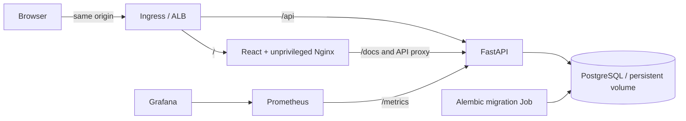
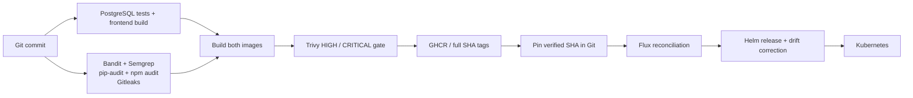
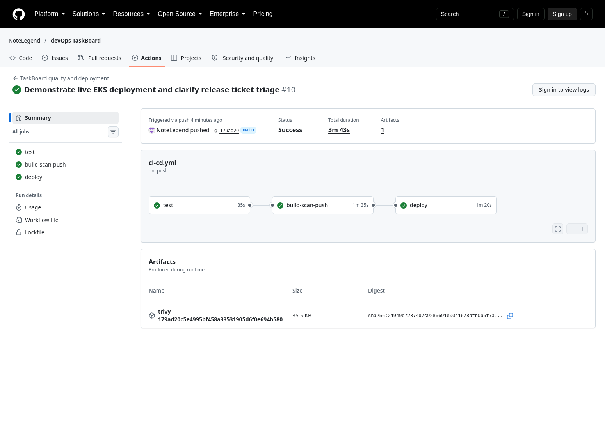
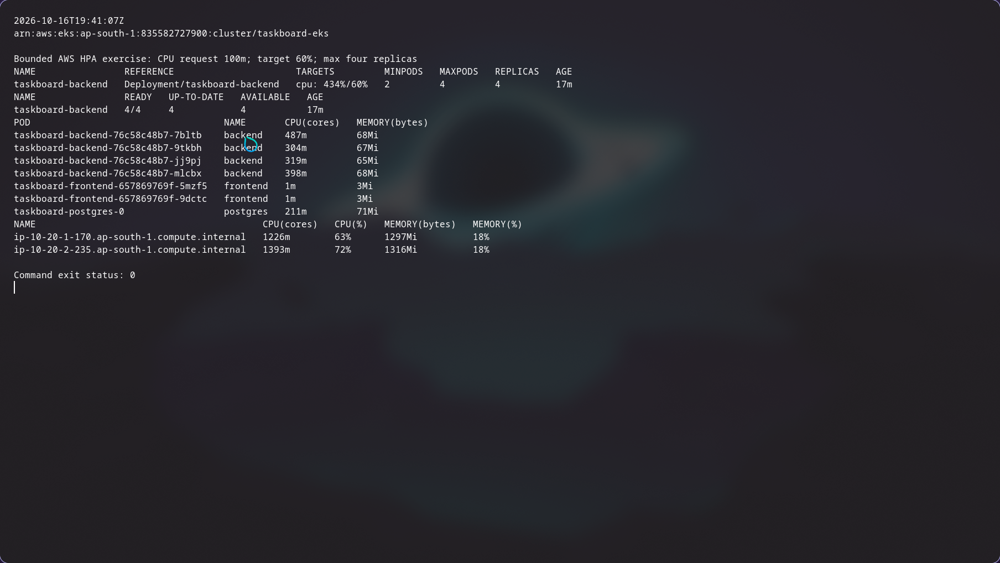

# Release Helpdesk

### Keep release work moving.

A service desk for deployment incidents, access requests and release follow-ups. Capture the problem, assign an owner, set a priority and track it through resolution—with a delivery platform that makes every release traceable.

[](https://github.com/NoteLegend/devOps-TaskBoard/actions/workflows/ci-cd.yml)
[Quick start](#quick-start) · [Architecture](#architecture) · [Delivery](#from-source-to-running-service) · [GitOps](gitops/README.md) · [Operations](docs/DEPLOYMENT.md)


## A clear path from incident to resolution

| Capture | Triage | Resolve |
|---|---|---|
| Open a ticket with the incident context and an assignee. | Search the queue; filter by priority or status; update ownership. | Move tickets through TODO, IN_PROGRESS and DONE; keep counts in sync. |

The responsive React interface includes validation, loading and empty states, safe error messages, edit/delete actions and browser-session activity. FastAPI exposes the ticket API and interactive documentation. PostgreSQL persists the records; Alembic owns schema changes.

## Quick start

Install Docker with Compose, then run from the repository root:

```bash
docker compose up --build -d --wait
python3 scripts/smoke.py http://localhost:3000
```

**Application:** http://localhost:3000 · **API explorer:** http://localhost:8000/docs

```bash
# Exercise the API against a dedicated migrated PostgreSQL database.
docker compose -f compose.test.yml up --build --abort-on-container-exit --exit-code-from tests
# Stop the app while retaining its database volume.
docker compose down
```

The local stack binds only to loopback and does not publish PostgreSQL. It uses synthetic demo data and has no end-user authentication. Database credentials are generated separately for Kubernetes; local Compose defaults are in [.env.example](.env.example).

## Architecture



Routes remain compatible with the original task API. `/health` checks the process, `/ready` verifies database/schema access, and `/metrics` exposes request counters and latency histograms. During a database outage the process can remain alive while readiness correctly rejects traffic.

## From source to running service



Tests and source-security gates must pass before image publication. Both images use the full commit SHA, and Trivy scans the images that are published. Pull requests validate changes without registry publication or AWS deployment. The existing cloud delivery path uses short-lived GitHub OIDC credentials and namespace-scoped deployment permissions.

[GitOps](gitops/README.md) adds a continuously reconciled deployment of the same application on local Kubernetes. Flux reads the public repository, applies its HelmRelease and corrects manual frontend drift. The backend HPA owns its replica count. Image promotion is an explicit reviewed change to the pinned SHA; it does not silently follow `latest`.

## Designed to be operated

| Concern | Approach |
|---|---|
| Repeatability | Compose locally; versioned Terraform for AWS; one Helm chart for application resources. |
| Data safety | Dedicated test databases, Alembic migration Job with advisory lock, persistent PostgreSQL storage. |
| Resource control | Non-root containers, CPU/memory requests and limits, backend HPA from 2 to 4 replicas. |
| Visibility | Prometheus ServiceMonitor, bounded metric labels and a versioned Grafana dashboard. |
| Failure diagnosis | Isolated broken-image and Service-selector exercises with recorded recovery. |
| Lifecycle | Account/credit guard, deliberate teardown and residual-resource inspection. |

The recorded AWS deployment demonstrated persistent data, real ALB traffic, HPA **2 → 4 → 2**, populated monitoring and successful failure recovery. The approved cloud environment was then removed; its old URL is offline. Local Compose and the local GitOps environment are the current reproduction paths. Exact revisions, dates and results are in the [verification record](docs/VERIFICATION.md).

<details>
<summary>See deployment and monitoring evidence</summary>






</details>

## Explore the repository

```text
application/   React interface, FastAPI service, migrations and tests
docker/        Backend and frontend image definitions
kubernetes/    Namespace, storage, deployment access and local cluster setup
helm/          Reusable application chart
terraform/    AWS VPC, EKS, IAM and storage infrastructure
.github/       Test, security, publish and approved deployment workflow
security/      Scanner versions, rules and security approach
monitoring/    Prometheus values and Grafana dashboard
gitops/        Flux source, reconciliation and Helm desired state
scripts/       Bootstrap, verification, load and packaging tools
images/        Original screenshots and browser recording
evidence/      Dated execution logs and machine-readable results
```

[Application](application/README.md) · [Containers](docker/README.md) · [Helm](helm/README.md) · [Infrastructure](terraform/README.md) · [Security](security/README.md) · [Monitoring](monitoring/README.md) · [Troubleshooting](docs/TROUBLESHOOTING.md)

## Engineering lessons

A successful rollout is only the start of verification: external API behavior must work too. Database readiness is different from process liveness. A large request count does not prove autoscaling; ready replicas and CPU measurements do. Security results are tied to a particular source revision, image and advisory database. GitOps closes the loop by correcting differences between committed intent and the running system.

For a production service, add end-user identity, HTTPS and DNS, managed database backups and alerting appropriate to the service's objectives.

## License and origin

Adapted from the MIT-licensed [TaskBoard starter](https://github.com/Nency-Ravaliya/devops-heros/tree/a4e39b6b3a54dab1efd386c75ab86bf1d8a23454/session21-python), with a release-helpdesk workflow and substantial application/platform changes. See [LICENSE](LICENSE), [attribution](docs/ATTRIBUTION.md) and [third-party notices](third_party/README.md).
