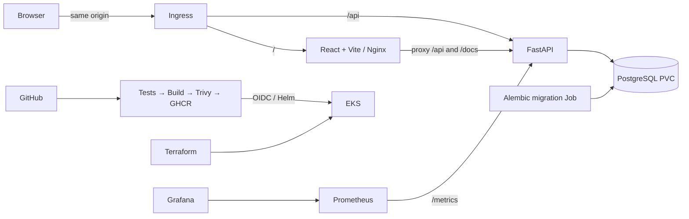

# Release Helpdesk

Rushi Jadhav’s Session 21 capstone: a DevOps service desk for deployment incidents, access requests and release follow-ups. Adapted from TaskBoard; existing API paths and fields remain compatible. Use synthetic classroom data. This classroom app has no end-user authentication; restrict access for demonstrations.



Tools: Python 3.13, React/Vite (locked in `frontend/package-lock.json`), PostgreSQL 16, Docker Compose, GitHub Actions, Trivy, Terraform, EKS 1.35, Helm, AWS Load Balancer Controller, Metrics Server, kube-prometheus-stack. Exact installed versions and results: [verification](docs/VERIFICATION.md).

## Run locally

```bash
docker compose up --build -d --wait
python3 scripts/smoke.py http://localhost:3000
docker compose -f compose.test.yml up --abort-on-container-exit --exit-code-from tests
```

Open http://localhost:3000 and http://localhost:8000/docs. `/health` checks the process, `/ready` checks the database and tasks table, `/metrics` exposes actual request instrumentation. Browser API calls use `/api`, never a cluster hostname. Local credentials are classroom defaults in `.env.example`; cloud secrets are generated separately. Ports bind only to loopback; PostgreSQL has no published host port.

```bash
# Stop while retaining application data:
docker compose down
# Start again:
docker compose up -d --wait
# Frontend outside Docker:
cd frontend
npm ci
npm run build
npm run dev
```

For Python development, create `backend/.venv` using Python 3.13, install `backend/requirements.txt`, configure `DATABASE_URL` to a reachable PostgreSQL database, then run `alembic upgrade head` and `uvicorn app.main:app --port 8000` from `backend/`. Run `pytest -v` there for isolated SQLite unit tests. Set `TEST_DATABASE_URL` to a **dedicated migrated test PostgreSQL database** for integration tests; tests truncate its tasks table.

## Deployment and submission

Follow [setup](docs/USER_SETUP.md), [deployment](docs/DEPLOYMENT.md), then the [demo sequence](docs/DEMO.md). Do not apply Terraform before the actual plan/cost checkpoint is approved. [Requirements](docs/REQUIREMENTS.md), [audit](docs/STARTER_AUDIT.md), [troubleshooting](docs/TROUBLESHOOTING.md), [cleanup](docs/CLEANUP.md), and [evidence](evidence/README.md) track what is implemented and what actually ran.

**Submission status: not yet ready.** See [verification](docs/VERIFICATION.md) for current blockers; local results do not establish an AWS deployment or successful Actions run.

Source: Nensi Ravaliya’s MIT-licensed [TaskBoard starter](https://github.com/Nency-Ravaliya/devops-heros/tree/a4e39b6b3a54dab1efd386c75ab86bf1d8a23454/session21-python). [Attribution](docs/ATTRIBUTION.md), [LICENSE](LICENSE), and the original [grading rubric](GRADING.md) are retained. Meaningful changes include ticket triage UI, edit/delete/search, safe errors, expanded tests, migration isolation, corrected routing, OIDC/RBAC, storage integration and reproducible verification.
