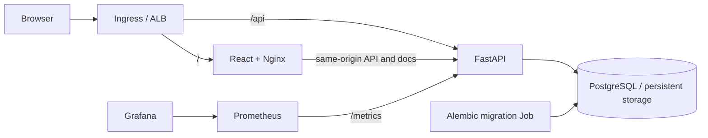
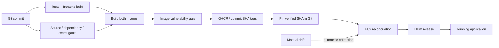
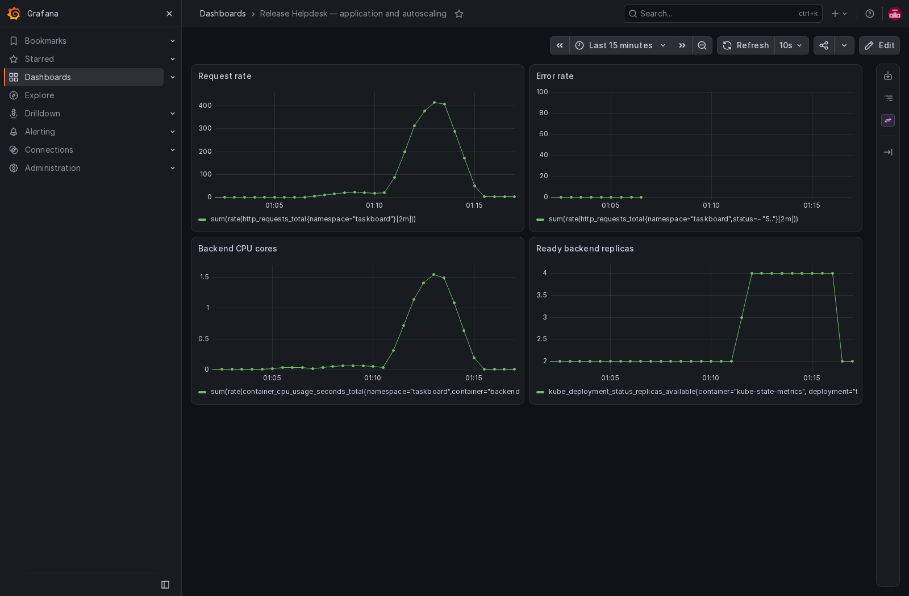
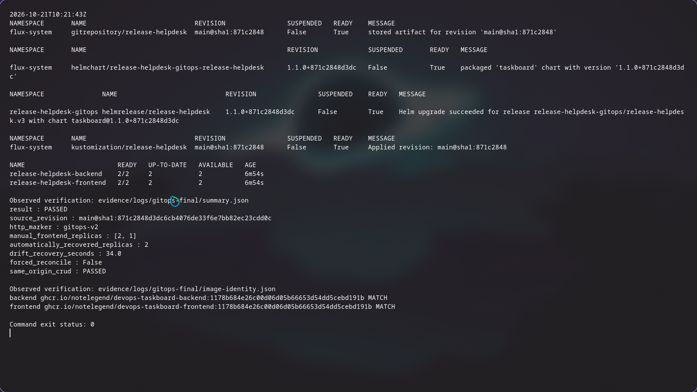

# Release Helpdesk

### Resolve the incident. Keep the release moving.

A service desk for deployment incidents, access requests and release follow-ups—backed by a tested, scanned and observable delivery platform.

[](https://github.com/NoteLegend/devOps-TaskBoard/actions/workflows/ci-cd.yml)

**[Watch the demo](https://drive.google.com/file/d/1ZSxd5RlMJAqJkvLA3E_098BrKF4OgJLT/view?usp=sharing)** · **[View the presentation](presentation/Release-Helpdesk-Presentation.pdf)** · **[Download PowerPoint](presentation/Release-Helpdesk-Presentation.pptx?raw=1)**

[Run locally](#run-locally) · [How it works](#how-it-works) · [Delivery approach](#from-commit-to-running-service) · [Documentation](docs/README.md)

[](https://drive.google.com/file/d/1ZSxd5RlMJAqJkvLA3E_098BrKF4OgJLT/view?usp=sharing)

## The problem

A blocked deployment rarely arrives as a neatly tracked task. An incident needs context, an access request needs an owner, and a release follow-up needs a clear next step. When that work is scattered, teams lose sight of who is responsible and what remains unresolved.

The delivery process needs the same clarity: which change was tested, which image is running, whether the service can handle traffic, and how it recovers when something breaks.

## The approach

Release Helpdesk connects a focused ticket workflow with a reproducible application platform.

| Capture | Triage | Resolve |
|---|---|---|
| Record the incident or request with context and an owner. | Search the queue, filter by priority/status, and update the ticket. | Move work through TODO → IN_PROGRESS → DONE and see queue counts update. |

React provides the responsive workspace. FastAPI validates the ticket contract. PostgreSQL stores the records, while Alembic manages schema changes. The interface includes edit/delete actions, loading and empty states, useful errors and browser-session activity.

## How it works



The browser uses one origin. `/health` checks the process; `/ready` checks database/schema access. A service can stay alive while correctly refusing traffic during a database outage.

## From commit to running service



- **Verify before publishing:** PostgreSQL tests, frontend build and security gates must pass before images reach the registry.
- **Make releases traceable:** full commit-SHA image tags connect running artifacts to their source. Promotion is an explicit Git change.
- **Keep operations measurable:** probes control readiness, HPA responds to CPU, and Prometheus/Grafana expose service behavior. Flux restores committed intent after drift.

[Security design](security/README.md) · [GitOps approach](gitops/README.md) · [Monitoring](monitoring/README.md)

## Run locally

With Docker and Compose installed, run from the repository root:

```bash
docker compose up --build -d --wait
python3 scripts/smoke.py http://localhost:3000
```

**Workspace:** http://localhost:3000 · **API explorer:** http://localhost:8000/docs

```bash
# Run tests against a separate migrated PostgreSQL database.
docker compose -f compose.test.yml up --build --abort-on-container-exit --exit-code-from tests
# Stop the application; retain its database volume.
docker compose down
```

The local stack uses loopback ports and synthetic data. End-user authentication is outside its current scope. [Development guide](application/README.md) · [Container setup](docker/README.md)

## Measured behavior

| What was verified | Observed result | Evidence |
|---|---|---|
| API correctness | 19 cases passed in unit and PostgreSQL integration runs. | [Test output](evidence/logs/final-postgres-integration.txt) |
| AWS autoscaling | Ready backend replicas **2 → 4 → 2**; 68,466 successful load requests. | [HPA measurements](evidence/logs/aws-hpa-internal/summary.json) |
| GitOps recovery | Manual frontend drift **2 → 1 → 2**, corrected in **34 seconds**. | [Flux verification](evidence/logs/gitops-final/summary.json) |
| Artifact identity | Both running image digests matched the published registry manifests. | [Digest checks](evidence/logs/gitops-final/image-identity.json) |

The AWS captures document the deployed system before its completed teardown. The historical cloud URL is offline; local Compose and kind remain the reproduction paths. [Full verification](docs/VERIFICATION.md)

| Application monitoring | GitOps reconciliation |
|---|---|
|  |  |

## Explore the system

| Area | Start here |
|---|---|
| User workflow and API | [Application](application/README.md) · [Frontend](application/frontend/README.md) · [Backend](application/backend/README.md) |
| Packaging and runtime | [Docker](docker/README.md) · [Kubernetes](kubernetes/README.md) · [Helm](helm/README.md) |
| Delivery and infrastructure | [GitOps](gitops/README.md) · [Terraform](terraform/README.md) · [Workflow](.github/workflows/ci-cd.yml) |
| Operating the service | [Security](security/README.md) · [Monitoring](monitoring/README.md) · [Troubleshooting](docs/TROUBLESHOOTING.md) |
| Walkthrough and proof | [Demo video](https://drive.google.com/file/d/1ZSxd5RlMJAqJkvLA3E_098BrKF4OgJLT/view?usp=sharing) · [Presentation](presentation/README.md) · [Screenshots](images/README.md) · [Execution evidence](evidence/README.md) |

## Lessons carried into the design

A successful rollout still needs a working external request. Readiness is different from liveness. Request volume alone does not prove scaling. Security results belong to a particular revision and scan date. GitOps adds the final feedback loop: the running service should converge on the state committed in Git.

## License and origin

Adapted from the MIT-licensed [TaskBoard starter](https://github.com/Nency-Ravaliya/devops-heros/tree/a4e39b6b3a54dab1efd386c75ab86bf1d8a23454/session21-python), with a release-helpdesk workflow and application/platform improvements. [License](LICENSE) · [Attribution](docs/ATTRIBUTION.md) · [Third-party notices](third_party/README.md)
