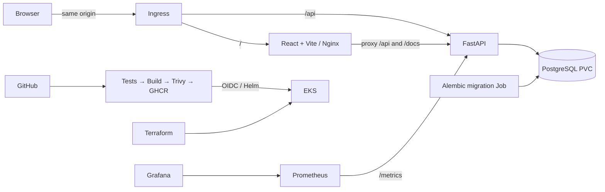

# Release Helpdesk

Rushi Jadhav’s Session 21 capstone: a DevOps service desk for deployment incidents, access requests and release follow-ups. Adapted from TaskBoard; existing API paths and fields remain compatible. Use synthetic classroom data. This classroom app has no end-user authentication; restrict access for demonstrations.



Tools: Python 3.13, React/Vite (locked in `frontend/package-lock.json`), PostgreSQL 16, Docker Compose, GitHub Actions, Trivy, Terraform, EKS 1.35, Helm, AWS Load Balancer Controller, Metrics Server, kube-prometheus-stack. Exact installed versions and results: [verification](docs/VERIFICATION.md).

## Run locally

```bash
docker compose up --build -d --wait
python3 scripts/smoke.py http://localhost:3000
docker compose -f compose.test.yml up --abort-on-container-exit --exit-code-from tests
```

Open http://localhost:3000 and http://localhost:8000/docs. `/health` checks the process, `/ready` checks the database and tasks table, `/metrics` exposes actual request instrumentation. Browser API calls use `/api`, never a cluster hostname. Local credentials are classroom defaults in `.env.example`; cloud secrets are generated separately. Ports bind only to loopback; PostgreSQL has no published host port.

```bash
# Stop while retaining application data:
docker compose down
# Start again:
docker compose up -d --wait
# Frontend outside Docker:
cd frontend
npm ci
npm run build
npm run dev
```

For Python development, create `backend/.venv` using Python 3.13, install `backend/requirements.txt`, configure `DATABASE_URL` to a reachable PostgreSQL database, then run `alembic upgrade head` and `uvicorn app.main:app --port 8000` from `backend/`. Run `pytest -v` there for isolated SQLite unit tests. Set `TEST_DATABASE_URL` to a **dedicated migrated test PostgreSQL database** for integration tests; tests truncate its tasks table.

## Verified publishing

[Repository](https://github.com/NoteLegend/devOps-TaskBoard) · [successful test/build/scan/publish run](https://github.com/NoteLegend/devOps-TaskBoard/actions/runs/38919741425) · [backend package](https://github.com/users/NoteLegend/packages/container/package/devops-taskboard-backend) · [frontend package](https://github.com/users/NoteLegend/packages/container/package/devops-taskboard-frontend). Both images were anonymously pulled. AWS deployment passed through GitHub OIDC and EKS using the approved Free account plan/credits. [Actual successful deployment](https://github.com/NoteLegend/devOps-TaskBoard/actions/runs/38955563228). No Paid-plan upgrade was performed.

Both local Kubernetes and real AWS EKS passed Ingress CRUD, persistent PostgreSQL, actual Prometheus/Grafana data, both isolated failure exercises, and CPU autoscaling from two to four and back to two replicas. Full evidence and limitations are in [verification](docs/VERIFICATION.md).

## Deployment and submission

Follow [setup](docs/USER_SETUP.md), [deployment](docs/DEPLOYMENT.md), then the [demo sequence](docs/DEMO.md). The original AWS/EKS scope remains required. Only the verified ACTIVE FREE account and eligible workers may be used; no Paid-plan upgrade or cash spending is authorized. Do not apply Terraform before the actual plan/credit-use/lifetime checkpoint is approved. [Requirements](docs/REQUIREMENTS.md), [audit](docs/STARTER_AUDIT.md), [troubleshooting](docs/TROUBLESHOOTING.md), [cleanup](docs/CLEANUP.md), and [evidence](evidence/README.md) track what is implemented and what actually ran.

**AWS technical verification passed; final evidence push and authorized teardown are in progress.** [Screenshots and actual walkthrough](images/README.md), [verification](docs/VERIFICATION.md), [remaining handover](docs/REMAINING.md). The student presentation/instructor submission remains a user action.

Source: Nensi Ravaliya’s MIT-licensed [TaskBoard starter](https://github.com/Nency-Ravaliya/devops-heros/tree/a4e39b6b3a54dab1efd386c75ab86bf1d8a23454/session21-python). [Attribution](docs/ATTRIBUTION.md), [LICENSE](LICENSE), and the original [grading rubric](GRADING.md) are retained. Meaningful changes include ticket triage UI, edit/delete/search, safe errors, expanded tests, migration isolation, corrected routing, OIDC/RBAC, storage integration and reproducible verification.

## AWS demonstration evidence

Live application commit: `179ad20c5e4995bf458a33531905d6f0e694b580`. The browser calls same-origin `/api` routes through the actual ALB. The user requires shutdown after deployment evidence is pushed; the AWS URL is historical after cleanup. Use Docker Compose above for a repeatable local review without recreating AWS resources.


[Real pipeline](images/aws-ci-successful-deployment.png) · [EKS Console](images/aws-eks-active-console.png) · [CPU scaling](images/aws-hpa-scaled-under-load.png) · [Grafana](images/aws-grafana-live-dashboard.png).
