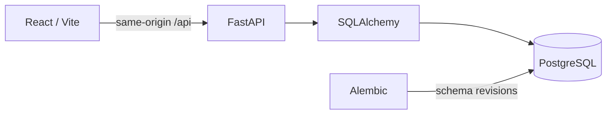

# Application

A release-helpdesk interface backed by a validated ticket API and persistent PostgreSQL records.

| Component | Responsibility |
|---|---|
| [Frontend](frontend/README.md) | Ticket capture, ownership, priority/status filters, search and edit/delete flows. |
| [Backend](backend/README.md) | REST contract, validation, safe failures, metrics and database access. |
| Database | Persist ticket records, with schema changes managed by Alembic. |

Start the complete stack from the repository root with `docker compose up --build -d --wait`. The browser uses `/api`; it never needs a Kubernetes service hostname. [Container lifecycle](../docker/README.md) · [deployment guide](../docs/DEPLOYMENT.md).
