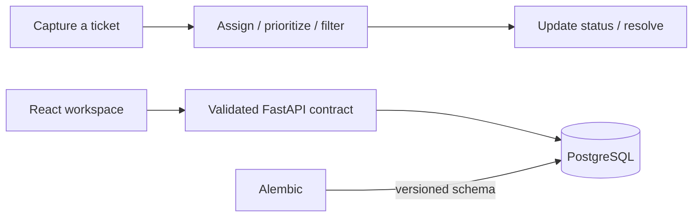

# The application

Release Helpdesk keeps release incidents and requests in one queue, with clear ownership, priority and progress.

## Problem

An operational issue needs more than a title: the team needs context, an owner and a visible path to resolution. The interface and API must agree on that state even when requests fail or the database is temporarily unavailable.

## Approach

| Component | Responsibility |
|---|---|
| [Frontend](frontend/README.md) | Ticket creation, search, filters, editing and responsive feedback. |
| [Backend](backend/README.md) | Validated CRUD/statistics, safe errors, readiness and metrics. |
| PostgreSQL | Durable ticket records, with Alembic owning the schema. |

## Try it

From the project root, run `docker compose up --build -d --wait`. Open http://localhost:3000 and http://localhost:8000/docs.

[Watch the demo](https://drive.google.com/file/d/1ZSxd5RlMJAqJkvLA3E_098BrKF4OgJLT/view?usp=sharing) · [Container setup](../docker/README.md) · [Architecture](../README.md#how-it-works)
