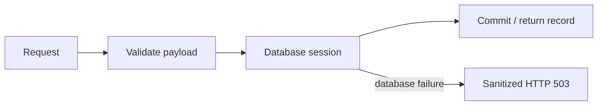

# Ticket API

FastAPI exposes ticket lifecycle operations, queue statistics and operational endpoints. SQLAlchemy handles records; Alembic is the schema authority.

| Method | Route | Purpose |
|---|---|---|
| GET | `/api/tasks` | List tickets. |
| GET | `/api/tasks/{id}` | Read one ticket. |
| GET | `/api/tasks/stats` | Return queue counts by status. |
| POST | `/api/tasks` | Create a validated ticket. |
| PUT | `/api/tasks/{id}` | Update selected fields. |
| DELETE | `/api/tasks/{id}` | Delete a ticket. |
| GET | `/health`, `/ready`, `/metrics` | Liveness, database readiness and Prometheus instrumentation. |

## Run and develop

Use Python 3.13, a virtual environment and the pinned `requirements.txt`. Configure a reachable PostgreSQL `DATABASE_URL`, then run from this directory:

```bash
alembic upgrade head
uvicorn app.main:app --host 127.0.0.1 --port 8000
pytest -v
```

Swagger is available at `/docs`. Tests default to isolated in-memory SQLite. Set `TEST_DATABASE_URL` only to a dedicated migrated test PostgreSQL database: integration tests truncate its tasks table. The root `compose.test.yml` creates that isolated environment.

## Failure and data behavior



Validation rejects unknown fields, blank titles, out-of-range lengths, invalid enums and explicit null updates. `/ready` accesses the tasks table; `/health` checks the process independently. Database driver details are never returned to clients.

Deployment migrations run once in a Helm hook Job, protected by a PostgreSQL advisory lock. Request instrumentation records counters and latency using bounded route-template labels. [Security](../../security/README.md) · [verification](../../docs/VERIFICATION.md).
