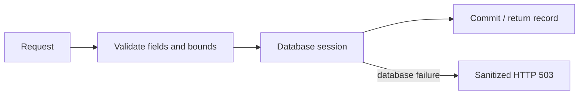

# Ticket API

A validated API for ticket lifecycle operations, queue statistics and service health.

## Problem

The UI needs predictable responses and durable data. Invalid updates must not reach the database, and a failed database connection must not expose driver details to the caller.

## Approach



FastAPI defines the contract, SQLAlchemy manages records and Alembic owns schema changes. Validation rejects unknown fields, blank titles, invalid enums and explicit null updates. A single migration Job uses a PostgreSQL advisory lock during deployment.

| Method | Route | Purpose |
|---|---|---|
| GET | `/api/tasks` | List tickets. |
| GET | `/api/tasks/{id}` | Read one ticket. |
| GET | `/api/tasks/stats` | Return counts by status. |
| POST | `/api/tasks` | Create a ticket. |
| PUT | `/api/tasks/{id}` | Update selected fields. |
| DELETE | `/api/tasks/{id}` | Delete a ticket. |

`/health` checks the process; `/ready` checks database/schema access; `/metrics` exposes request counters and latency with bounded route-template labels. Swagger is available at `/docs`.

## Develop and verify

Use Python 3.13 and a virtual environment. Install `requirements.txt` and configure `DATABASE_URL` for a reachable PostgreSQL database, then run from this directory:

```bash
alembic upgrade head
uvicorn app.main:app --host 127.0.0.1 --port 8000
pytest -v
```

Tests default to isolated in-memory SQLite. PostgreSQL integration tests require a dedicated, migrated `TEST_DATABASE_URL` and truncate that test table. The root `compose.test.yml` supplies the isolated environment.

[Application](../README.md) · [Test results](../../evidence/logs/final-postgres-integration.txt) · [Security](../../security/README.md)
