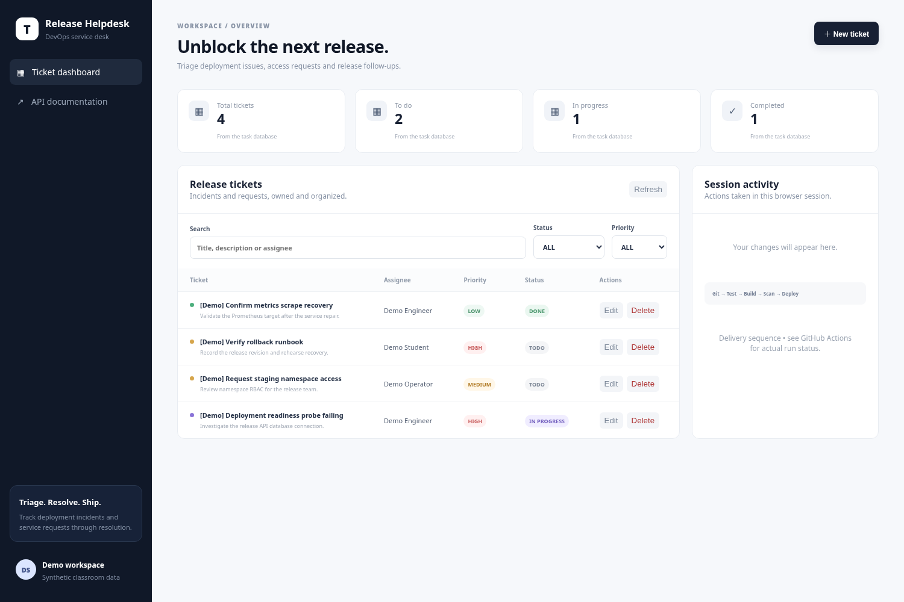
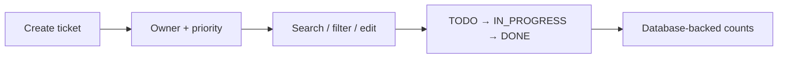

# Ticket workspace

A responsive React workspace that keeps release incidents, owners and next steps visible.



## Problem

A queue is useful only when people can find the right work, change it confidently and understand whether an action succeeded.

## Approach



The UI supports edit/delete actions, validation, loading/empty/error states and mobile layouts. The activity feed records actions in the current browser session. All API calls use the same origin: Vite proxies during development, and Nginx proxies API/documentation routes in the packaged app.

## Develop and verify

```bash
npm ci
npm run build
npm run dev
```

With a reachable application, `npm run test:browser` exercises create, edit, filters, delete, mobile layout and Swagger. Set `BASE_URL` for the target and `EVIDENCE_DIR` for screenshots. `RECORD_https://drive.google.com/file/d/1ZSxd5RlMJAqJkvLA3E_098BrKF4OgJLT/view?usp=sharing_DIR` and `DEMO_SLOWMO_MS` support browser capture.

[Watch the demo](https://drive.google.com/file/d/1ZSxd5RlMJAqJkvLA3E_098BrKF4OgJLT/view?usp=sharing) · [API](../backend/README.md) · [Image definition](../../docker/frontend.Dockerfile) · [Frontend security rules](../../security/semgrep.yml)
