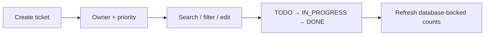

# Ticket workspace

A responsive React interface for release incidents and requests. The UI keeps ownership, priority and progress visible while the API remains the source of truth.


## Workflow



The interface supports edit/delete actions, validation, loading/empty/error states and mobile layouts. The activity feed describes actions taken in the current browser session. It does not claim to be a persisted audit log.

```bash
npm ci
npm run build
npm run dev
```

Vite development proxies `/api` to the API. In the packaged application Nginx serves static assets and proxies API/documentation routes. Browser requests stay on the same origin.

`npm run test:browser` exercises create, edit, filter, delete, mobile layout, Swagger and routing. Start a reachable application first; use `BASE_URL` to select it and `EVIDENCE_DIR` to choose an output directory. [Container image](../../docker/frontend.Dockerfile) · [security rules](../../security/semgrep.yml).
