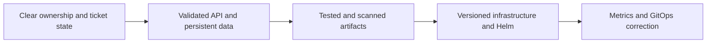

# Project guide

Start with the problem and architecture, then follow the service from local development to release and operation.

| I want to… | Read |
|---|---|
| Understand the product and design | [Project overview](../README.md) · [Application](../application/README.md) |
| Watch the system in action | [Recorded demo](https://drive.google.com/file/d/1ZSxd5RlMJAqJkvLA3E_098BrKF4OgJLT/view?usp=sharing) · [Presentation](../presentation/README.md) |
| Run or develop it | [Quick start](../README.md#run-locally) · [Setup](USER_SETUP.md) |
| Understand packaging and releases | [Containers](../docker/README.md) · [Helm](../helm/README.md) · [GitOps](../gitops/README.md) |
| Deploy and inspect it | [Deployment](DEPLOYMENT.md) · [Infrastructure](../terraform/README.md) |
| Understand quality and feedback | [Security](../security/README.md) · [Monitoring](../monitoring/README.md) |
| Investigate a failure | [Troubleshooting](TROUBLESHOOTING.md) · [Verification walkthrough](DEMO.md) |
| Check what actually ran | [Execution record](VERIFICATION.md) · [Evidence](../evidence/README.md) · [Screenshots](../images/README.md) |
| Review resource cleanup | [Cleanup](CLEANUP.md) · [Cost checkpoint](COST_CHECKPOINT.md) |

## Design in one view

The product READMEs explain responsibilities and tradeoffs. Runbooks contain operational commands; verification records preserve dates, revisions and outcomes. Detailed [coverage](REQUIREMENTS.md) and [attribution](ATTRIBUTION.md) stay separate from the main product story.
