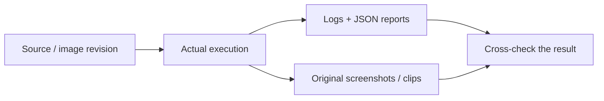

# Execution evidence

Connect the system's claims to source revisions, actual commands and observed behavior.

## Approach

| Area | What the records demonstrate |
|---|---|
| [Security](logs/security-final/) | Source analysis, dependency audits and redacted secret scans. |
| [Initial findings](logs/security-initial/) | Failures that led to a repair or narrowly scoped classification. |
| [GitOps](logs/gitops-final/) | Source revision, release promotion, manual drift and automatic correction. |
| [Autoscaling](logs/aws-hpa-internal/summary.json) | Ready replicas 2 → 4 → 2 and measured load. |
| [Monitoring](logs/aws-prometheus-queries.json) | Real application queries and metrics. |
| [Teardown](logs/aws-cleanup-verification.json) | Recorded residual-resource checks after destruction. |

The AWS lifecycle and later local/security executions retain their own dates and revisions. Failed attempts remain alongside successful recoveries; the earlier external load that did not scale is preserved too.

[Watch the recorded demo](https://drive.google.com/file/d/1ZSxd5RlMJAqJkvLA3E_098BrKF4OgJLT/view?usp=sharing) · [Presentation](../presentation/README.md) · [Visual library](../images/README.md) · [Verification record](../docs/VERIFICATION.md)
