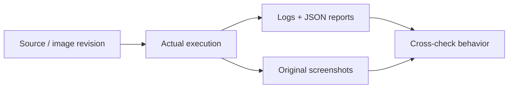

# Execution evidence

Dated output connects implementation claims to actual commands, source revisions and observed behavior. Historical failures are retained alongside successful repairs.

| Evidence set | What it shows |
|---|---|
| [Source security](logs/security-final/) | Bandit, Semgrep, dependency audits and redacted secret scans. |
| [Initial security findings](logs/security-initial/) | The advisory and metadata findings that prompted a fix or narrow classification. |
| [GitOps](logs/gitops-final/) | Flux revision/readiness, controlled frontend drift and automatic recovery. |
| [AWS HPA](logs/aws-hpa-internal/summary.json) | Ready replicas 2 → 4 → 2 and measured load results. |
| [AWS monitoring](logs/aws-prometheus-queries.json) | Actual application scrape/query responses. |
| [AWS teardown](logs/aws-cleanup-verification.json) | Recorded residual-resource checks after the destroy. |
| [Screenshot/video library](../images/README.md) | Original browser, console, pipeline, monitoring and terminal captures. |

The 16 October cloud lifecycle and later local/security work are labelled separately. The cloud endpoint is intentionally offline. Clean scans apply to the saved revision and advisory data at scan time. The original external load that did not scale is retained; the later isolated in-cluster run supplied the observed scaling proof.

[Verification record](../docs/VERIFICATION.md) · [deployment guide](../docs/DEPLOYMENT.md) · [cleanup record](../docs/CLEANUP.md).
