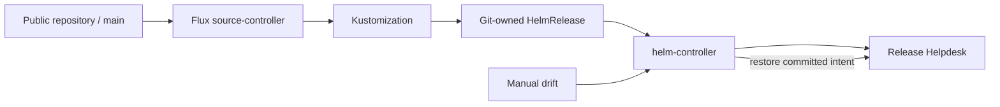

# GitOps reconciliation

Committed intent continuously reconciled with the running application.

## Problem

A successful deployment can still drift later. A manual replica change or configuration edit should be visible and recoverable without relying on someone to notice and repeat the deployment.

## Approach



Flux deploys the same application and chart into `release-helpdesk-gitops` on local kind. Image promotion pins verified full-SHA tags in Git. A release-marker change updates an HTTP header and triggers a real frontend rollout.

Frontend replicas belong to Git; backend replicas belong to the HPA. Drift detection preserves that ownership boundary. Database credentials are generated separately and the public Git source needs no write token.

| Definition | Responsibility |
|---|---|
| `clusters/local/source.yaml` | Repository source and reconciliation path. |
| `releases/release.yaml` | Chart, image tags, release settings and drift detection. |
| `releases/namespace.yaml` | Isolated application namespace. |

## Run and verify

Use kind with Metrics Server, default storage and Prometheus Operator installed. [Local bootstrap](../scripts/bootstrap-local.sh) supplies these prerequisites. With the Flux 2.9.6 CLI:

```bash
export PATH="$PWD/.tools:$PATH"
kubectl config use-context kind-taskboard-local
bash scripts/bootstrap-gitops.sh
python3 scripts/verify-gitops.py --expect-marker gitops-v2
flux get all -A
```

The verifier deliberately changes frontend replicas from 2 to 1 and waits for automatic restoration to 2, without a forced reconcile or manual repair. It also checks the Git revision, HTTP marker and CRUD behavior.

**Observed:** recovery in **34 seconds**, with both running image digests matching GHCR. [Recovery record](../evidence/logs/gitops-final/summary.json) · [Image identity](../evidence/logs/gitops-final/image-identity.json)

For browser access, run `kubectl port-forward -n release-helpdesk-gitops svc/release-helpdesk-frontend 8099:8080` and open http://localhost:8099. The historical AWS environment is separate and has been removed.

[Watch the demo](https://drive.google.com/file/d/1ZSxd5RlMJAqJkvLA3E_098BrKF4OgJLT/view?usp=sharing) · [Helm](../helm/README.md) · [Controller behavior](https://fluxcd.io/flux/components/helm/helmreleases/#drift-detection)
