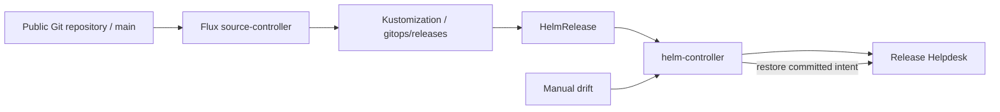

# GitOps reconciliation

Flux continuously reconciles the committed Helm desired state of Release Helpdesk. This is the same React/FastAPI/PostgreSQL application and chart used by the recorded cloud deployment.



| Path | Purpose |
|---|---|
| `clusters/local/source.yaml` | Public Git source and reconciliation path. |
| `releases/release.yaml` | Helm chart, immutable image SHA, release settings and drift detection. |
| `releases/namespace.yaml` | Isolated `release-helpdesk-gitops` namespace. |

## Start the local environment

Use a running kind cluster with Metrics Server, the default storage class and Prometheus Operator installed. The local bootstrap supplies those prerequisites. Install the Flux 2.9.6 CLI, select the local context, then run:

```bash
export PATH="$PWD/.tools:$PATH"
kubectl config use-context kind-taskboard-local
bash scripts/bootstrap-gitops.sh
kubectl port-forward -n release-helpdesk-gitops svc/release-helpdesk-frontend 8099:8080
```

Open http://localhost:8099. The bootstrap installs source/kustomize/helm controllers, generates a runtime database Secret, and points Flux at this public repository. It needs no GitHub write token. The original `taskboard` namespace is a separate deployment and is not adopted or overwritten.

## Promote and verify

Promote a release by updating both full image-SHA tags in `releases/release.yaml` after CI publication. Commit and push the change; Flux fetches Git and upgrades the Helm release. A `releaseMarker` update changes the HTTP `X-Release-Version` response and triggers the frontend config-checksum rollout.

```bash
python3 scripts/verify-gitops.py --expect-marker gitops-v1
flux get all -A
```

The verifier deliberately changes the frontend replica count from 2 to 1 and waits for the controller to restore 2. It does not force Flux reconciliation or run Helm/kubectl apply to repair the drift. It also checks the Git revision, Helm readiness, HTTP release marker and same-origin CRUD. The backend HPA continues to own its replica field.

[Recorded GitOps verification](../evidence/logs/gitops-final/) · [controller behavior](https://fluxcd.io/flux/components/helm/helmreleases/#drift-detection).

The GitOps target is local kind. The historical AWS environment has been torn down; enabling cloud GitOps would require its own approved infrastructure target, runtime Secret and environment values.
