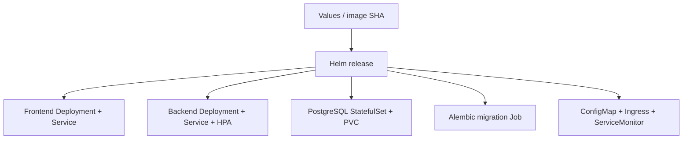

# Application chart

`taskboard/` packages the complete service as one repeatable Helm release. Internal resource names preserve the original API/chart compatibility; the product is Release Helpdesk.



| Configuration | Use |
|---|---|
| `values.yaml` | Shared defaults, resource bounds, 2 frontend replicas and backend HPA 2–4. |
| `values-dev.yaml` | Local ingress settings. |
| `values-prod.yaml` | ALB Ingress, encrypted gp3 storage and application ServiceMonitor. |
| [Flux HelmRelease](../gitops/releases/release.yaml) | Local Git-owned release using immutable registry image tags. |

```bash
helm lint helm/taskboard
helm template taskboard helm/taskboard -f helm/taskboard/values-prod.yaml
```

Generate `taskboard-runtime` separately; chart values never contain its password. The migration hook waits for the database and uses an advisory lock. First-install waits are handled deliberately so API readiness cannot deadlock the post-install migration. Deployment scripts verify rollouts and external behavior after Helm returns.

Changes to Nginx configuration update a Pod-template checksum and trigger a frontend rollout. `releaseMarker` appears in `X-Release-Version`, providing a readable configuration-promotion signal. The backend HPA owns replica count; Flux drift detection excludes that field while keeping frontend replicas under Git control.

[Operations](../docs/DEPLOYMENT.md) · [GitOps](../gitops/README.md) · [troubleshooting](../docs/TROUBLESHOOTING.md).
