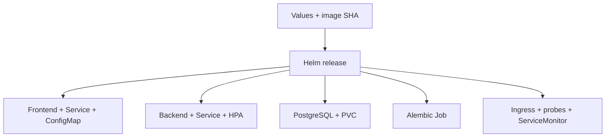

# Application chart

One versioned definition for the interface, API, database and operational resources.

## Problem

Manually edited manifests drift across environments. Schema changes, runtime configuration and workload readiness also need to happen in a predictable order.

## Approach



`taskboard/` retains compatible internal names while packaging Release Helpdesk. Shared defaults and environment-specific values keep the application definition consistent.

| Configuration | Purpose |
|---|---|
| `values.yaml` | Resource bounds, two frontend replicas and backend HPA from 2 to 4. |
| `values-dev.yaml` | Local ingress settings. |
| `values-prod.yaml` | AWS ALB, gp3 storage and ServiceMonitor. |
| [Flux HelmRelease](../gitops/releases/release.yaml) | Git-owned local deployment with immutable image tags. |

Migrations run in one hook Job with an advisory lock. Runtime credentials come from a separately generated Secret. An Nginx configuration checksum triggers a frontend rollout; `releaseMarker` appears in the HTTP `X-Release-Version` header. Backend replica ownership stays with the HPA.

## Inspect the release definition

```bash
helm lint helm/taskboard
helm template taskboard helm/taskboard -f helm/taskboard/values-prod.yaml
```

First-install waits are handled so API readiness does not block the post-install migration. Deployment verification checks real rollouts and HTTP behavior after Helm returns.

[Operations](../docs/DEPLOYMENT.md) · [GitOps promotion](../gitops/README.md) · [Troubleshooting](../docs/TROUBLESHOOTING.md)
