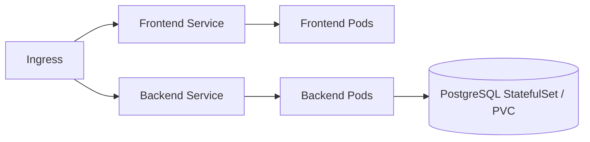

# Kubernetes runtime

Stable routing and persistent data around replaceable application Pods.

## Problem

Pods come and go. Traffic needs a stable destination, data must survive replacement, and workloads need the right access and storage in each environment.

## Approach

| Foundation | Purpose |
|---|---|
| `kind.yaml` | Local cluster with loopback ingress on port 8088. |
| `namespace.yaml` | Application isolation. |
| `deployer-rbac.yaml` | Namespace-scoped deployment access. |
| `gp3.yaml` | Encrypted EBS storage for AWS. |

The [Helm chart](../helm/README.md) owns workloads, Services, ConfigMap, Secret references, migration Job, Ingress, probes, HPA and persistence. Environment values select local or AWS routing/storage.

## Use it

Choose [local bootstrap](../scripts/bootstrap-local.sh) for direct Helm management or [GitOps bootstrap](../scripts/bootstrap-gitops.sh) for the isolated Flux-managed release. Both use an explicitly selected local kind context. AWS setup requires EBS CSI and the infrastructure prerequisites in the [deployment guide](../docs/DEPLOYMENT.md).

[Helm](../helm/README.md) · [GitOps](../gitops/README.md) · [Failure diagnosis](../docs/TROUBLESHOOTING.md)
