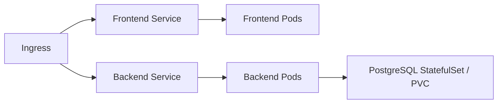

# Kubernetes foundations

These resources prepare the cluster around the application Helm release.

| File | Responsibility |
|---|---|
| `kind.yaml` | Local kind cluster with loopback ingress access on port 8088. |
| `namespace.yaml` | Application namespace. |
| `deployer-rbac.yaml` | Namespace-scoped permissions for the GitHub deployment group. |
| `gp3.yaml` | Encrypted AWS EBS storage class. |

The reusable workload resources live in [the Helm chart](../helm/README.md): Deployments, Services, Nginx ConfigMap, Secret references, PostgreSQL StatefulSet/PVC, migration Job, Ingress, HPA and probes.

Use [local bootstrap](../scripts/bootstrap-local.sh) for the direct Helm environment or [GitOps bootstrap](../scripts/bootstrap-gitops.sh) for an isolated Flux-managed instance. Both expect the local kind context explicitly. Cloud preparation is documented in [deployment](../docs/DEPLOYMENT.md); `gp3.yaml` requires EBS CSI and should not be applied to kind.
