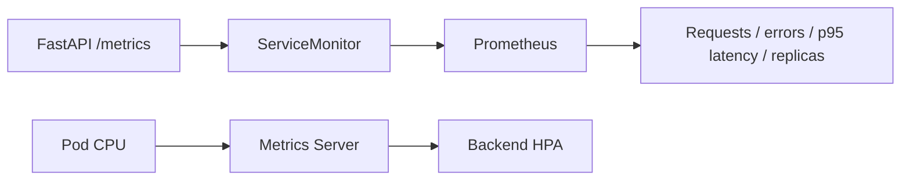

# Application observability

Understand traffic, latency, errors and scaling using measurements from the running service.

## Problem

A running Pod is not proof of a healthy service. Operators need to see whether requests arrive, which responses fail, how latency changes and whether capacity responds to demand.

## Approach

`prometheus-values.yaml` configures kube-prometheus-stack. `dashboard.json` defines the versioned dashboard. Route-template labels keep request instrumentation bounded; the ServiceMonitor selects the backend's named HTTP port.

Metrics Server supplies HPA CPU measurements independently of Prometheus. Grafana and Prometheus remain private ClusterIP Services, accessed through port-forwarding.

## Inspect behavior

Confirm application targets are **UP**, send real requests and inspect increasing counters and populated panels. The recorded database-restart exercise includes a real readiness interruption, preserved in the error-rate data.

[Access instructions](../docs/DEPLOYMENT.md) · [Prometheus targets](../images/aws-prometheus-targets-up.png) · [Current GitOps metrics](../evidence/logs/gitops-final/monitoring.json) · [Recorded AWS queries](../evidence/logs/aws-prometheus-queries.json)
