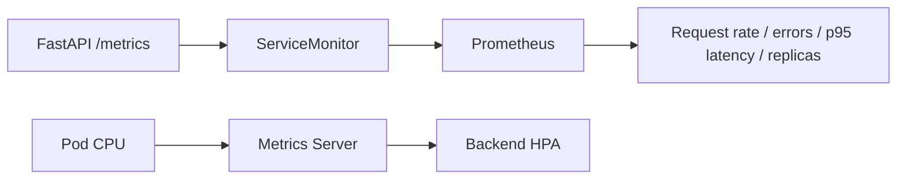

# Application observability

Prometheus collects actual FastAPI request measurements; Grafana turns them into a service dashboard. Metrics Server independently supplies the CPU measurements used by the backend HPA.

`prometheus-values.yaml` configures kube-prometheus-stack. `dashboard.json` is the versioned Grafana dashboard. The chart's ServiceMonitor uses the backend Service's named HTTP port and matching release selectors.

Grafana and Prometheus remain private ClusterIP Services. Follow [the port-forward instructions](../docs/DEPLOYMENT.md) to inspect them. Credentials are generated at runtime, not stored in values or screenshots.

Verify more than installation: confirm the application target is **UP**, run real traffic, inspect increasing counters and check populated panels. The saved database-restart exercise includes a real readiness interruption; the dashboard is not presented as a zero-error production SLO.

[Metrics capture](../images/aws-metrics-endpoint.png) · [Prometheus targets](../images/aws-prometheus-targets-up.png) · [query results](../evidence/logs/aws-prometheus-queries.json).
