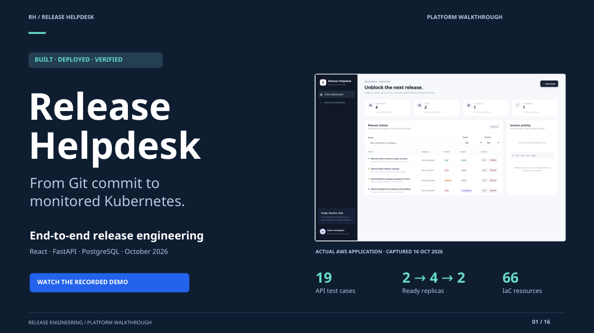
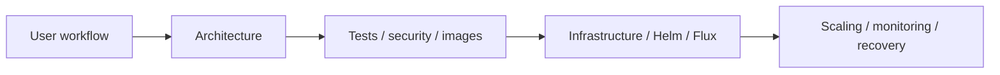

# Project walkthrough

The problem, design choices and measured behavior of Release Helpdesk, explained through a recorded demo and an illustrated 16-slide deck.

| Format | Open it |
|---|---|
| Recorded demo | [Watch on Google Drive](https://drive.google.com/file/d/1ZSxd5RlMJAqJkvLA3E_098BrKF4OgJLT/view?usp=sharing) |
| Presentation | [Read the PDF](Release-Helpdesk-Presentation.pdf) |
| Editable slides | [Download PowerPoint](Release-Helpdesk-Presentation.pptx?raw=1) |
| Supporting material | [Speaker notes and evidence links](Demo-and-Speaker-Notes.md) |

## What it covers

The deck uses original screenshots, editable diagrams and a chart built from recorded HPA observations. AWS captures document the cloud run before teardown; later security and GitOps evidence belongs to the same application on local kind.

Open the PPTX in PowerPoint or LibreOffice Impress, or import it into Google Slides. The PDF provides a consistent viewing copy. `build_presentation.py` regenerates the deck, PDF and notes using python-pptx, reportlab and Pillow with Noto Sans and DejaVu Sans.

[Project overview](../README.md) · [Architecture and operations guides](../docs/README.md) · [Verification](../docs/VERIFICATION.md)
