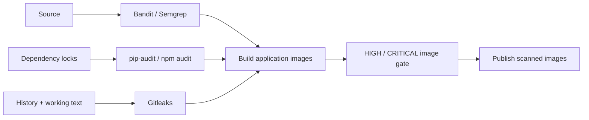

# Security before publication

Source, dependencies, repository history and final images all have a release gate.

## Problem

Passing functional tests does not reveal every unsafe code pattern, vulnerable package or committed credential. Each risk needs a check at the point where it can stop a release.

## Approach



| Layer | Scope and failure policy |
|---|---|
| Bandit | Python application/migrations; findings fail the gate. |
| Semgrep | Selected frontend execution/HTML/shell risks; rule matches fail. |
| pip-audit | Complete pinned Python dependency set; known vulnerabilities fail. |
| npm audit | Frontend dependency graph including build/dev packages; any severity fails. |
| Gitleaks | Full reachable history and tracked/unignored working text; unexcepted findings fail. |
| Trivy | Both final images; all HIGH/CRITICAL findings fail, including unfixed findings. |

CI requires the source-security and test jobs before building/publishing. Its report directory starts fresh for each run. Local source/dependency/secret checks use the same commands:

```bash
python3 -m venv .tools/security-venv
.tools/security-venv/bin/pip install -r security/requirements.txt
export PATH="$PWD/.tools/security-venv/bin:$PWD/.tools:$PATH"
bash scripts/security-scan.sh all
```

Install checksum-verified Gitleaks 8.30.1 in `.tools/` first; the [workflow](../.github/workflows/ci-cd.yml) contains its exact installation steps. Trivy runs against built images separately.

## Fix and verify

A dependency audit caught the [certifi trust-store advisory](https://github.com/advisories/GHSA-6q48-6c7w-9gw2); the lock was upgraded to 2026.10.19 and images rebuilt. Gitleaks' exception is limited to an exact public CPython signing fingerprint in explicitly listed archived image reports. Unsafe Python, unsafe JavaScript and a synthetic secret still fail their negative controls.

Runtime secrets stay outside Git. Cloud delivery uses short-lived OIDC credentials and namespace-scoped access. Results are tied to the source/image and advisory data at scan time.

[Final reports](../evidence/logs/security-final/) · [Initial findings](../evidence/logs/security-initial/) · [Negative controls](../evidence/logs/security-final/negative-controls.json) · [Verification](../docs/VERIFICATION.md)
