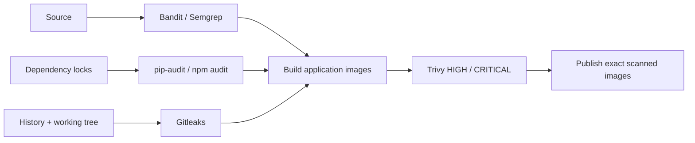

# Security gates

Release Helpdesk checks source code, dependencies, repository secrets and final images before publication. The same gate commands run locally and in GitHub Actions.



| Layer | Scope | Failure policy |
|---|---|---|
| Bandit | Python application and migrations. | Any reported finding fails. |
| Semgrep | Frontend source; checked-in rules for dynamic execution, raw HTML and shell execution. | Any matching rule fails. |
| pip-audit | Complete pinned Python application dependency list. | Any known vulnerability fails. |
| npm audit | Frontend dependency graph, including development/build packages. | Any reported severity fails. |
| Gitleaks | Full reachable Git history and tracked/unignored working text. | Any unexcepted finding fails; reports redact values. |
| Trivy | OS and language packages in both final images. | All HIGH/CRITICAL findings fail, including unfixed findings. |

## Run locally

Install Python 3.13 scanner dependencies and the checksum-verified Gitleaks 8.30.1 binary, then run from the project root:

```bash
python3 -m venv .tools/security-venv
.tools/security-venv/bin/pip install -r security/requirements.txt
export PATH="$PWD/.tools/security-venv/bin:$PWD/.tools:$PATH"
bash scripts/security-scan.sh all
```

`all` runs source, dependency and secret gates; Trivy runs against the images in the delivery workflow. Individual `sast`, `sca` and `secrets` stages are also available. Reports are written to `evidence/logs/security-final/` and uploaded as CI artifacts.

## Findings lead to fixes

A fresh dependency scan detected [the certifi trust-store advisory](https://github.com/advisories/GHSA-6q48-6c7w-9gw2). The Python lock was updated to certifi 2026.10.19 and the images rebuilt. The initial report is preserved in [security-initial](../evidence/logs/security-initial/); final reports and hosted artifacts record the result after repair.

Gitleaks initially identified public CPython release-signing fingerprints in archived Trivy image reports. `gitleaks.toml` exempts only that exact public fingerprint in the explicitly listed backend-report paths. It does not exclude application source, complete evidence directories or arbitrary key values. Synthetic negative controls verify that unsafe source and a fake secret still stop the gates.

Deployment authentication uses GitHub OIDC with exact main-branch trust and namespace-scoped Kubernetes RBAC. Runtime database secrets are generated outside Git and are not included in source archives. Clean scans are dated observations, not a guarantee against future vulnerabilities or all classes of application weakness.
