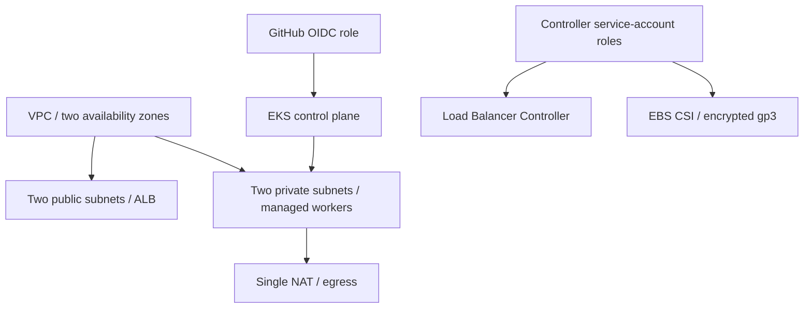

# AWS infrastructure

A versioned network, Kubernetes cluster and identity/storage foundation.

## Problem

Kubernetes manages workloads, but the surrounding network, workers, permissions and persistent storage must also be reproducible. Ad hoc infrastructure is difficult to review and easy to leave running.

## Approach



Modules/providers are versioned and the provider lockfile is retained. The account is explicit, operator/deployment access is separate, and controller roles are tied to service accounts. Two workers and one NAT gateway balance the demonstration's needs and resource use.

## Validate and operate

```bash
terraform -chdir=terraform init
terraform -chdir=terraform fmt -check
terraform -chdir=terraform validate
```

Use `terraform.tfvars.example` for inputs; keep real variables, state and plans private. Provisioning follows an approved plan, cost budget and lifetime.

The real AWS lifecycle created and later destroyed **66 Terraform resources**. Screenshots and residual checks were preserved before teardown. The old cloud URL is offline; local environments remain reproducible.

[Deployment](../docs/DEPLOYMENT.md) · [Plan capture](../images/aws-terraform-plan.png) · [Cost checkpoint](../docs/COST_CHECKPOINT.md) · [Cleanup record](../docs/CLEANUP.md)
