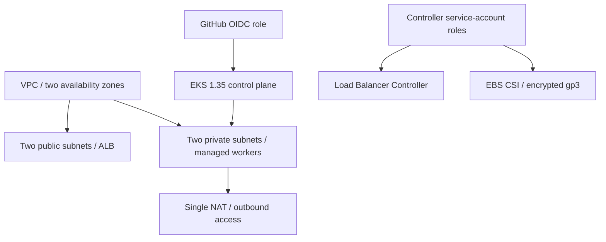

# AWS infrastructure

Versioned Terraform provisions the network, EKS cluster and identity/storage integrations used by the recorded cloud deployment.



Modules and providers are versioned; the provider lockfile is retained. The account ID is explicit, operator and deployment access are separate, and the workflow assumes short-lived credentials. The two-worker configuration and a single NAT gateway are deliberate demonstration choices, not a claim of full production high availability.

```bash
terraform -chdir=terraform init
terraform -chdir=terraform fmt -check
terraform -chdir=terraform validate
```

Use `terraform.tfvars.example` as a template and keep real variables/state/plans private. Provisioning requires an approved account, actual plan, cost budget and lifetime. Authentication alone does not authorize spending.

The recorded apply created **66 resources**. Evidence was preserved before the authorized destroy removed them. The historical ALB URL is offline. The KMS key was disabled and scheduled for deletion; settled billing is not inferred from delayed credit reports.

[Deployment](../docs/DEPLOYMENT.md) · [cost checkpoint](../docs/COST_CHECKPOINT.md) · [completed teardown](../docs/CLEANUP.md) · [actual plan](../images/aws-terraform-plan.png).
